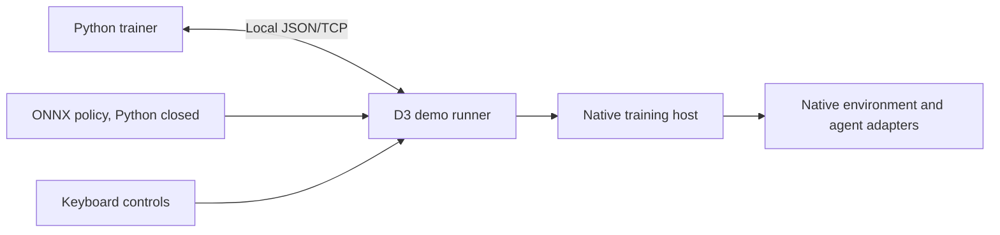

# Schola for Godot

Schola for Godot ports AMD's reinforcement-learning toolkit to Godot 4.7. Developers define environments and agents with native nodes, train a policy through Python, and run exported ONNX policies inside Godot without shipping Python. CSC301 Team 20 develops the port in partnership with AMD.

## Partner introduction

- **Primary contact:** Alexander Cann, Member of Technical Staff, [alexander.cann@amd.com](mailto:alexander.cann@amd.com)
- **Secondary contact:** TianYue "Michael" Liu, Senior Software Engineer, [tianyliu@amd.com](mailto:tianyliu@amd.com)

## D3 improvement highlight

D3 replaces the D2 demo's scripted environment and lifecycle stand-ins with native `ScholaEnvironment`, `ScholaAgent`, and `ScholaTrainingHost` implementations. The current 2D grid-world adds editable maps and a viewer for parallel training, and runs exported ONNX policies through the current per-agent state API. Training still uses a temporary localhost JSON/TCP connector and tabular Q-learning; production gRPC integration is unfinished.

Read the [D3 demo guide](Godot/demo/d3/README.md) for controls and the [product-evolution report](deliverables/D3/product-evolution.md) for the D2 comparison, implementation decisions, evidence, and remaining work.



## D2 feedback addressed

- **Replace integration stand-ins (D2 review):** D3 replaces the scripted environment and lifecycle. The temporary JSON/TCP training connector remains and is labelled as temporary until the gRPC connector is finished.
- **Keep the learning visible (TA demo feedback):** the D3 demo keeps episode statistics and a reward graph, so progress can be seen during training.
- **One step callback (AMD):** separate reward, termination, truncation, and info callbacks were ambiguous, so `ScholaEnvironment` now uses one `_get_step_result(agent)` callback.
- **No built-in step limit (AMD):** a built-in maximum could conflict with custom truncation logic, so it was removed and developers control truncation in `_get_step_result(agent)`.
- **Blocking connector loop (AMD):** delaying actions and rewards harms reinforcement learning, so `poll_tick` was removed and the loop keeps its blocking `tick`.
- **Clearer ONNX policy setup and errors (AMD):** `ScholaOnnxPolicy` now initializes from an agent through `initialize(agent)`, and US7 Godot classes report failures through one shared error path.
- **Sequence length from the model (AMD):** we checked `max_state_sequence_length`. Unreal also sets it by hand, and ONNX Runtime's C API cannot read the metadata on individual inputs, so it stays manual for now and reading it from the model is proposed as [US14](Godot/docs/user_stories/US14.md).

## Deployed URL and access instructions

This is a native Godot plugin and desktop demo, so deployment means downloadable applications rather than a hosted web page.

- [GitHub releases](https://github.com/csc301-2026-f/20-AMD-Schola/releases): successful Godot CI runs on `main` publish commit-specific **D3 development** prereleases. Select a release with attached Windows x86_64, Linux x86_64, or macOS arm64 archives.
- [D3 release](https://github.com/csc301-2026-f/20-AMD-Schola/releases/tag/D3): the course snapshot, available after the team pushes the `D3` tag and packaging succeeds. Until then, use a development prerelease or the source setup below.
- [Godot Actions](https://github.com/csc301-2026-f/20-AMD-Schola/actions/workflows/godot.yml): PR checks and downloadable package artifacts. PRs build and check packages without publishing releases.

Download the D3 application for [Windows x86_64](https://github.com/csc301-2026-f/20-AMD-Schola/releases/download/D3/Schola-D3-Windows-x86_64.zip), [Linux x86_64](https://github.com/csc301-2026-f/20-AMD-Schola/releases/download/D3/Schola-D3-Linux-x86_64.tar.gz), or [macOS arm64](https://github.com/csc301-2026-f/20-AMD-Schola/releases/download/D3/Schola-D3-macOS-arm64.zip). These canonical links become available automatically when the pushed `D3` tag's packaging workflow succeeds. The [validated candidate run](https://github.com/csc301-2026-f/20-AMD-Schola/actions/runs/42157175290) passed all checks at commit `4c02a76`, including exported reference-policy playback on all three platforms.

Extract the archive for your platform and launch the included application. The package includes a deterministic reference ONNX policy for the default map; it is a shortest-path reference, not evidence of a learned policy. **Arrow keys** move the agent, **Policy** runs the bundled model with Python closed, and **Stop** returns to manual control. **Edit map** changes the layout. The policy fits the default map, so restore **Default** before using it after map edits.

Training and the parallel-training viewer require the source checkout, Python packages, and a Godot executable. The packaged inference demonstration does not require Python. Unsigned applications may require your operating system's usual permission to open downloaded software.

## Instructions

For source setup, use Git, Python 3.12, Godot 4.7.2, and a C++17 compiler. On Windows use Visual Studio 2022 with Desktop development with C++; on Linux use a supported GCC or Clang toolchain; on macOS use Xcode command-line tools and `arch=arm64`. The [development guide](Godot/README.md#supported-toolchain) owns the full dependency and build instructions.

From the repository root:

```sh
git submodule update --init --recursive
python -m venv .venv
```

Activate the environment with `.venv\Scripts\Activate.ps1` in PowerShell or `source .venv/bin/activate` in a POSIX shell, then install:

```sh
python -m pip install --require-hashes -r Godot/requirements.txt
python -m pip install -r Godot/demo/d3/python/requirements.txt
python Godot/tools/setup_onnxruntime.py
```

Build the runtime needed by the D3 demo, without the unfinished production transport:

```sh
# Windows developer shell
scons -C Godot schola platform=windows target=template_debug
```

On Linux use `platform=linux`; on macOS use `platform=macos arch=arm64`. Copy the runtime libraries into the demo's corresponding `addons/schola/bin/<platform>/` directory using the [D3 guide](Godot/demo/d3/README.md#run). Generate the default reference model, import, and launch:

```sh
python Godot/demo/d3/python/create_reference_policy.py
python Godot/demo/d3/python/export_onnx.py
godot --headless --path Godot/demo/d3 --editor --quit
godot --path Godot/demo/d3
```

Here `godot` means your Godot 4.7.2 executable. For training from the editor, set the `Runner` node's `python_executable` to the absolute path of your virtual environment's Python before pressing F5.

## Key use cases

1. **Inspect an episode:** move with the arrow keys; reach the goal, hit a hazard, or reach the 40-step limit. Compare the displayed reward and outcome.
2. **Train and deploy a policy:** select **Train**, let episodes accumulate, then **Stop** to save and export. Select **Policy** to reload the ONNX model and run it locally. Missing or incompatible models produce a message in the log panel.
3. **Change the task:** select **Edit map**, move the goal or toggle hazards, then save. Retrain for the new layout; the observation does not encode hazards, so policies do not generalize to arbitrary maps.
4. **Train in parallel:** select **Parallel training**, choose the instance and episode counts, and start. Separate headless Godot processes contribute experience to one shared Q-table. Use this workflow from the source project.

## Non-functional requirements

- **Input validation:** native spaces validate observations and actions. The runner rejects invalid Python actions before calling the host, and map validation rejects invalid dimensions, out-of-bounds goals, and hazards on the goal. Use **Check US2** for visible validation examples. See [space tests](Godot/tests/unit/spaces_test.cpp) and [D3 smoke checks](Godot/demo/d3/tests/d3_smoke.gd).
- **Error handling and reliability:** the UI reports waiting, connected, training, closed, and error states. Training has connection and step timeouts. A closed host session requires a scene reload; **Reload** provides recovery. Native lifecycle tests cover reset, step, completion, routing, and failure behavior.
- **Local communication:** the demo listens on loopback by default and requires no service credentials. It has no authentication layer and is intended for trusted local use. Production gRPC security and remote deployment remain outside the demonstrated D3 workflow.
- **Access and interaction:** manual play uses arrow keys, the panel names actions and connection states, and outcomes have textual labels as well as color. Full keyboard access to map editing and screen-reader support have not been verified; we do not claim a completed accessibility audit.
- **Packaging:** exported demos exclude `schola_training` and include ONNX Runtime. CI smoke-tests the source project and exported packages with a required model. Native dependency downloads use pinned versions and checksums; no deployment secret is needed beyond GitHub's scoped workflow token.

The D2 review identified the need to replace integration stand-ins and keep the training-to-inference example small. D3 addresses the environment, lifecycle, and inference boundaries while explicitly retaining the temporary training connector. See the [D2 review](deliverables/D2/iteration-02-review.md) and [D3 report](deliverables/D3/product-evolution.md).

## Testing and CI/CD

[Godot CI](.github/workflows/godot.yml) checks C++ formatting, dependency setup, native builds, Catch2 unit/inference/transport suites, and GdUnit4 integration tests. Its D3 checks generate a reference model, verify host behavior and policy success, then train two instances for 20 total episodes, export the learned table, and load that model in Godot after the trainer exits. This short training check verifies integration, not learning quality.

[D3 packaging](.github/workflows/d3-release.yml) builds runtime-only debug and release libraries for Windows, Linux, and macOS, checks the demo and exported package, and uploads archives. Relevant PRs must pass packaging as part of `Godot / required`. Successful runs on `main` automatically publish commit-specific development releases; pushing `D3` publishes the final snapshot. Manual dispatch and `D3-test-*` tags build artifacts without publishing. Jobs have explicit timeouts; native compilation has longer limits than lightweight checks.

To run the D3 check locally after setup:

```sh
godot --headless --path Godot/demo/d3 -s res://tests/d3_smoke.gd -- --require-policy --expect-success
```

Use `--expect-success` with the default reference model; omit it for a newly trained model whose success rate is not yet established. See the [development guide](Godot/README.md) for the native and GdUnit4 test commands. Workflow definitions describe intended automation; the [Actions results](https://github.com/csc301-2026-f/20-AMD-Schola/actions) establish which revision and platforms have actually passed.

## Project structure

- [`Godot/src`](Godot/src): production C++ core, Godot bindings, inference, and transport work.
- [`Godot/demo/d3`](Godot/demo/d3): current D3 example, trainer, and smoke checks.
- [`Godot/tests`](Godot/tests): native and Godot integration suites.
- [`Godot/docs/user_stories`](Godot/docs/user_stories): current scope, ownership, and remaining work.
- [`deliverables/D3`](deliverables/D3): product-evolution report and contribution record.

## D2 product

The [D2 release](https://github.com/csc301-2026-f/20-AMD-Schola/releases/tag/D2), [demo guide](Godot/demo/d2/README.md), and [video](https://youtu.be/AGgiJN7cSnE) preserve the submitted D2 implementation. Its 3D grid-world used scripted environment/lifecycle stand-ins and the earlier inference interface. D2 files and packages remain historical snapshots.

## D1 prototype

The [D1 prototype](Godot/demo/d1) and [video](https://youtu.be/zg4K3fiQjJw) preserve the initial C# interface experiment. The current port uses C++ GDExtensions.

## Development requirements

Use the [Godot development guide](Godot/README.md) for toolchain pins, builds, test commands, architecture, and packaging. The full training extension additionally requires the committed gRPC package installed by `Godot/tools/setup_grpc.py`; the D3 demo uses only the runtime extension.

## Deployment and GitHub workflow

Use feature branches and pull requests with meaningful descriptions and teammate review before merging. CI validates changes; the packaging workflow distributes successful `main` revisions. Follow [CONTRIBUTING.md](CONTRIBUTING.md) and the [Godot development contract](Godot/docs/development_contract.md). Shared protocol changes must preserve Schola's cross-engine semantics.

## Project resources

- [D3 report](deliverables/D3/product-evolution.md) and [individual contributions](deliverables/D3/Individual_Contributions_Deliverable3.md)
- [Current stories](Godot/docs/user_stories/README.md) and [remaining integration work](Godot/docs/user_stories/remaining.md)
- [Team meeting records](deliverables/team/minutes/)
- [Trello board](https://trello.com/b/Ry0Qkx2R)
- [Upstream Schola README](README-upstream.md)

## License

[MIT License](LICENSE.txt), matching AMD Schola.
