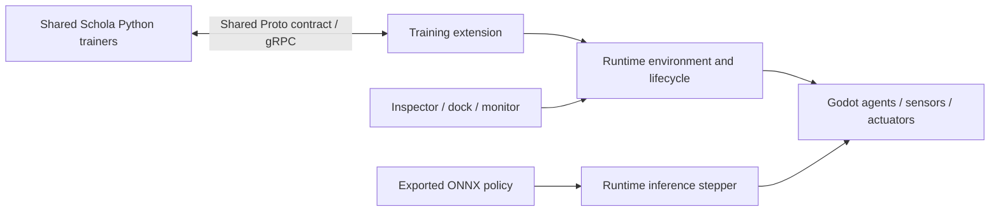

# Schola for Godot

Schola for Godot brings AMD's reinforcement-learning toolkit to Godot 4.7. Developers define agents and environments with native Godot nodes, train through Schola's Python tools, and run exported ONNX policies inside a game without shipping Python. CSC301 Team 20 develops this C++ GDExtension port in partnership with AMD.

## Problem and project scope

AMD Schola already supports Unreal Engine. This project adds a Godot integration while preserving the shared Python tools and protocol. Our contribution lives under `Godot/`: environment and agent APIs, spaces, episode lifecycle, Python training connector, local inference, reusable components, and editor tools. The existing Unreal implementation under `Source/` and upstream Python package under `Resources/python/` provide the shared foundation.

The [user stories](Godot/docs/user_stories/README.md) define the final course scope. Their individual records distinguish implementation, integration evidence, and outstanding verification. Historical demos are preserved separately and are not the current plugin's training interface.

## Access and installation

- **Release/prod:** download your platform's `Schola-Godot-<platform>-<arch>.zip` from the [D4 release](https://github.com/csc301-2026-f/20-AMD-Schola/releases/tag/D4).
- **Dev:** open a successful `main` run of [Godot CI](https://github.com/csc301-2026-f/20-AMD-Schola/actions/workflows/godot.yml), then download its `schola-plugin-<platform>-<arch>` artifact. Extract the Actions artifact wrapper to find the plugin ZIP.
- **Training and development:** use the source checkout and the [development guide](Godot/README.md).

The plugin archives contain the runtime/editor add-on, debug and release native libraries, ONNX Runtime, licenses, and a source commit record. They support Windows x86_64, Linux x86_64, and macOS arm64. They exclude the Python training extension; production training is a source-build workflow on Windows or Linux.

With Godot closed, extract the plugin ZIP and copy its `addons/schola/` directory into your project's `addons/`. Open the project with Godot 4.7.2 and enable **AMD Schola** under **Project Settings > Plugins**. Preserve the archive's license notices when redistributing it. See [installation, distribution, and troubleshooting](Godot/docs/distribution.md) for the package layout and update procedure.

## Core workflows

1. **Define a task.** Add a `ScholaEnvironment` and child `ScholaAgent` nodes. Define observation/action spaces through Inspector resources or code; implement reset and `_get_step_result(agent)` for rewards and episode endings. See [code-defined spaces](Godot/examples/code_defined_spaces/README.md).
2. **Compose an agent.** Use reusable ray/camera sensors and movement, rotation, or teleport actuators, or implement custom observation/action hooks. See the [component guide](Godot/docs/us8_components.md) and [interactive component example](Godot/examples/us8_components/README.md).
3. **Inspect before training.** Use the Inspector's configuration warnings, Schola editor dock, and episode monitor. The [manual environment example](Godot/examples/manual_environment/README.md) exercises reset, actions, and results without Python.
4. **Train with Python.** Build both extensions and add `ScholaTrainingConnector` to your training scene. Start Godot, then connect Schola's supported Python trainer over localhost gRPC. The [training guide](Godot/README.md#train-with-python) explains timeouts, reconnects, and the training-only scene boundary.
5. **Train multiple agents.** One environment can expose agents with different spaces and independent episode results. Use RLlib for heterogeneous agents; follow the [two-agent example](Godot/examples/multi_agent/README.md).
6. **Run a policy locally.** Export the trained policy to ONNX, assign it to `ScholaOnnxPolicy`, and configure `ScholaInferenceStepper` with the agents to drive. Python is not required during playback. See [policy setup and observation stacking](Godot/README.md#running-a-trained-policy).

The production benchmark and real-training validation belong to [US13](Godot/docs/user_stories/US13.md). Follow its implementation record for the integrated example, training command, learning metric, export, and playback evidence. The final D4 scope also includes camera observations, stacking, and recurrent-policy metadata; platform and upstream constraints are recorded in the corresponding stories.

## Architecture and decisions

Engine-independent logic lives in `Godot/src/core`. Godot bindings, gRPC transport, and ONNX inference adapt their own APIs at module boundaries. Runtime and training are separate extensions, allowing exported games to omit the transport and Python tooling. The port uses C++ GDExtensions to integrate native dependencies and keep core logic testable independently of the editor. Godot scenes and components use GDScript where appropriate. See [module boundaries](Godot/README.md#module-boundaries) and the [development contract](Godot/docs/development_contract.md).

Partner feedback shaped the current interfaces: one step-result callback replaces separate reward/end-state callbacks; environments own truncation policy; training uses a blocking request/response loop; and policy initialization checks the agent's spaces. Current production training uses the shared gRPC protocol rather than the earlier demos' temporary transport.

## Non-Functional Requirements

| Requirement | Implementation and evidence |
| --- | --- |
| Validated inputs | Spaces reject invalid definitions and values; configuration warnings surface missing or incompatible agent/component setup. [Space unit tests](Godot/tests/unit/spaces_test.cpp), [space integration tests](Godot/tests/integration/spaces_test.gd), and [component tests](Godot/tests/integration/components_parity_test.gd). |
| Reliable episode lifecycle | Reset, step, per-agent results, completion, invalid-action rejection, and session failure are explicit. [Training-host integration tests](Godot/tests/integration/training_host_test.gd) and [multi-agent tests](Godot/tests/integration/multi_agent_training_test.gd). |
| Bounded communication and recovery | Connector start/step timeouts and normal-session reconnection distinguish waiting, closure, and failure. [Connector integration tests](Godot/tests/integration/training_connector_test.gd), native transport tests under `Godot/tests/transport/`, and [reconnection guidance](Godot/README.md#train-with-python). |
| Local inference and portable distribution | ONNX runs without Python; runtime-only packages omit training dependencies. Native inference suites under `Godot/tests/inference/` and clean-project package loading in [packaging CI](.github/workflows/godot-packages.yml). |
| Maintainability | Core excludes engine and technology headers; module-specific adapters own conversions. Pinned dependencies, clang-format, review, and automated suites support changes. [Contract](Godot/docs/development_contract.md), [dependency lock](Godot/dependencies.lock.json), and [CI](.github/workflows/godot.yml). |
| Useful Godot diagnostics | Inspector warnings, named errors, dock configuration, and a textual episode monitor support setup and debugging. [UI guide](Godot/README.md#inspect-the-schola-ui). Screen-reader support and a full accessibility audit are not claimed. |
| Communication boundary | Training defaults to loopback. There is no documented authentication/TLS deployment for untrusted networks; use trusted local training. [Connector configuration](Godot/README.md#train-with-python). |

These links identify test coverage and design evidence. [Actions results](https://github.com/csc301-2026-f/20-AMD-Schola/actions) establish whether a particular revision passed; synthetic fixtures and protocol tests alone do not establish learned-policy quality.

## Automated testing and distribution

[Godot CI](.github/workflows/godot.yml) runs for PRs, merge queues, and pushes to `main`. Relevant changes run C++ formatting, dependency integrity/installer checks, native unit/inference/transport suites, and headless Godot integration tests. Its required check includes platform plugin packaging. The tests exercise core logic and Godot-facing integration; package loading checks installation independently of the repository's example project.

For this desktop plugin, the two distribution environments are the **dev channel** (commit-specific Actions artifacts from successful `main` builds) and the **release/prod channel** (versioned GitHub release assets). Both are automatic and use the same reusable package workflow. The [D4 publisher](.github/workflows/d4-release.yml) retains its scheduled/manual triggers and publishes the plugin ZIPs after packaging succeeds. See the [distribution guide](Godot/docs/distribution.md) for exact contents and limitations.

Continue the D3 process: focused PRs, teammate review, passing checks, job timeouts, and adherence to the course GitHub Actions Resource Policy. Avoid unnecessary reruns and dependency source rebuilds. See [CONTRIBUTING.md](CONTRIBUTING.md) for the review workflow and local test commands.

## Maintaining and integrating the codebase

Start with the [AMD codebase map](Godot/docs/maintenance.md). It identifies the implementation, shared protocol/Python interfaces, build inputs, tests, documentation, and how to extend the plugin. Use the [developer README](Godot/README.md) for supported toolchains, a clean source setup, native builds, and test commands.

The course repository is the handoff reference. AMD can use its source and tagged snapshots when integrating the port into its own maintenance workflow. Destination repository, ongoing ownership, and integration arrangements are to be discussed with Alex; this documentation does not assign future maintenance obligations.

## Partner and project resources

- **AMD contact:** Alexander Cann, Member of Technical Staff, [alexander.cann@amd.com](mailto:alexander.cann@amd.com).
- **Secondary AMD contact:** TianYue "Michael" Liu, Senior Software Engineer, [tianyliu@amd.com](mailto:tianyliu@amd.com).
- [Current user stories](Godot/docs/user_stories/README.md) and [remaining integration/future opportunities](Godot/docs/user_stories/remaining.md).
- [Team meeting records](deliverables/team/minutes/) and [Trello board](https://trello.com/b/Ry0Qkx2R).
- Historical [D3 report](deliverables/D3/product-evolution.md), [D3 demo/video](https://youtu.be/JGB_9ZzR93k), [D2 release](https://github.com/csc301-2026-f/20-AMD-Schola/releases/tag/D2), and [D1 prototype](Godot/demo/d1/README.md).
- [Upstream Schola README](README-upstream.md).

## License

[MIT License](LICENSE.txt), matching AMD Schola. Distributed third-party components retain their own notices.
