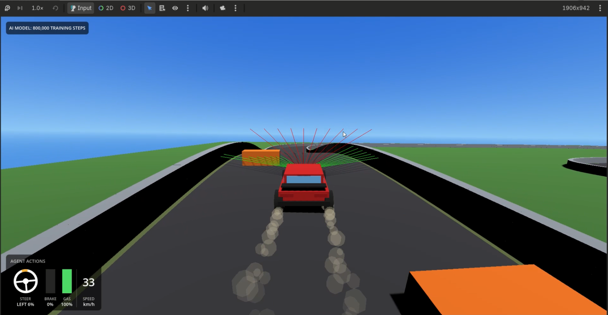
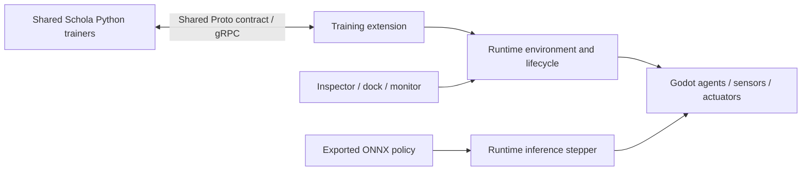

# Schola for Godot

Schola for Godot brings AMD's reinforcement-learning toolkit to Godot 4.7. Developers define agents and environments with native Godot nodes, train through Schola's Python tools, and run exported ONNX policies inside a game without shipping Python. CSC301 Team 20 develops this C++ GDExtension port in partnership with AMD.

## Problem and project scope

AMD Schola originally only supported the Unreal engine. This project gives Godot game developers, RL researchers, and simulation developers the same training-to-gameplay toolkit that the Unreal side with a native Godot user experience. This project is less of a port and more of a recreation of the benefits that Schola gave to Unreal, but instead for Godot. Our contribution lives under `Godot/` and the existing Unreal implementation exists under `Source/` however we reused its Python libraries under `Resources/python/`.

The [user stories](Godot/docs/user_stories/README.md) track approved MVP and stretch scope. Each record links the delivered behavior to its implementation and verification evidence. Historical demos are preserved separately and are not the current plugin's training interface.

## Access and installation

- **Godot Developer:** Download your platform’s `Schola-Godot-<platform>-<arch>.zip` from the [D4 release](https://github.com/csc301-2026-f/20-AMD-Schola/releases/tag/D4). Windows and Linux x86_64 support training and inference. The macOS arm64 ZIP supports inference and editor tools.
  - **Dependencies:**
    + Godot 4.7.2
    + Python 3.12 with pip, if you want to train models
  - **Setup:** Extract the ZIP and copy `addons/schola/` into your project’s `addons/` directory. Open the project and enable **AMD Schola** under **Project Settings > Plugins**.
  - **Training:** Also copy `addons/schola_training/` into your project. From the extracted ZIP folder, run `pip install "./python/schola-2.1.0-py3-none-any.whl[sb3]"` in your Python virtual environment. Replace `sb3` with `rllib` to use RLlib instead. Pip installs the selected trainer and its dependencies. See the [installation guide](Godot/docs/distribution.md) for how to start training.

- **Schola Developer:** Clone the repo with `git clone --recurse-submodules https://github.com/csc301-2026-f/20-AMD-Schola.git`.
  - **Dependencies:**
    + Godot 4.7.2
    + Python 3.12 with pip
    + Git LFS
    + A C++17 toolchain (GCC on Linux, MSVC on Windows, or Apple Clang on macOS)
  - **Setup:** Fetch the Git LFS assets, create and activate a Python virtual environment, and run `pip install --require-hashes -r Godot/requirements.txt` to install SCons. Run `python Godot/tools/setup_onnxruntime.py` and, if building the training addon on Windows or Linux, `python Godot/tools/setup_grpc.py`. Build with SCons and open the `Godot/` project. The [build guide](Godot/README.md#build-and-run) has the exact commands for each platform.
  - **Training:** From the repo root, run `pip install -e "Resources/python[sb3]"` for Stable-Baselines3, or replace `sb3` with `rllib` for RLlib. See [Train with Python](Godot/README.md#train-with-python) to connect the trainer to a scene.

For a recent development build, open a successful `main` run of [Godot CI](https://github.com/csc301-2026-f/20-AMD-Schola/actions/workflows/godot.yml) and download the `schola-plugin-<platform>-<arch>` artifact. Extract the artifact to find the plugin ZIP.
## Core workflows

1. **Define a task.** Add a `ScholaEnvironment` and child `ScholaAgent` nodes. Define observation/action spaces through Inspector resources or code; implement reset and `_get_step_result(agent)` for rewards and episode endings. See [code-defined spaces](Godot/examples/code_defined_spaces/README.md).
2. **Compose an agent.** Use reusable ray/camera sensors and movement, rotation, or teleport actuators, or implement custom observation/action hooks. See the [component guide](Godot/README.md#reusable-sensors-and-actuators) and [interactive component example](Godot/examples/us8_components/README.md).
3. **Inspect before training.** Use the Inspector's configuration warnings, Schola editor dock, and episode monitor. The [manual environment example](Godot/examples/manual_environment/README.md) exercises reset, actions, and results without Python.
4. **Connect Python training.** Install both extensions and the Python client from the [Windows or Linux package](Godot/docs/distribution.md#train-from-the-windows-or-linux-package), or build them from source. Add `ScholaTrainingConnector` to your training scene, start Godot, and connect the Python trainer over localhost gRPC. The [training guide](Godot/README.md#train-with-python) explains timeouts, reconnects, and the training-only scene boundary.
5. **Configure multiple agents.** One environment can expose agents with different spaces and independent episode results. Use RLlib for heterogeneous agents; follow the [two-agent example](Godot/examples/multi_agent/README.md). The Windows RLlib run completed 4,096 steps and 300 episodes; see [US12](Godot/docs/user_stories/US12.md) for the review record.
6. **Run a policy locally.** Export the trained policy to ONNX, assign it to `ScholaOnnxPolicy`, and configure `ScholaInferenceStepper` with the agents to drive. Python is not required during playback. See [policy setup and observation stacking](Godot/README.md#running-a-trained-policy).

Start with the [RaceTrack production example](Godot/examples/race_track/README.md) to train a car with Stable-Baselines3 PPO, export it to ONNX, and watch the committed policy with Python closed. Its evaluation compares trained and untrained policies on laps, contacts, obstacle avoidance, and random layouts. The [camera example](Godot/examples/camera_target/README.md) demonstrates image observations with a rendered viewport. Camera capture uses the latest completed frame and requires a display; headless training uses nonvisual sensors or the deterministic fake camera. Observation stacking and recurrent-model metadata are documented in the [inference guide](Godot/README.md#running-a-trained-policy).

Watch the [RaceTrack production example video](https://youtu.be/s9P6hWiZxb4) and read the [RaceTrack guide](Godot/examples/race_track/README.md) for controls, training, and evaluation results.

## Architecture and decisions

Engine-independent logic lives in `Godot/src/core`. Godot bindings, gRPC transport, and ONNX inference adapt their own APIs at module boundaries. Runtime and training are separate extensions, allowing exported games to omit the transport and Python tooling. The port uses C++ GDExtensions to integrate native dependencies and keep core logic testable independently of the editor. Godot scenes and components use GDScript where appropriate. See [module boundaries](Godot/README.md#module-boundaries) and the [development contract](Godot/docs/development_contract.md).

Partner feedback shaped the current interfaces: one step-result callback replaces separate reward/end-state callbacks; environments own truncation policy; training uses a blocking request/response loop; and policy initialization checks the agent's spaces. The production connector uses the shared gRPC protocol and existing Schola Python wrappers. RaceTrack exercises the complete training, export, and local inference workflow; the earlier demos remain historical snapshots.

## Non-Functional Requirements

| Requirement | Implementation and evidence |
| --- | --- |
| Validated inputs | Spaces reject invalid definitions and values; configuration warnings surface missing or incompatible agent/component setup. [Space unit tests](Godot/tests/unit/spaces_test.cpp), [space integration tests](Godot/tests/integration/spaces_test.gd), and [component tests](Godot/tests/integration/components_parity_test.gd). |
| Reliable episode lifecycle | Reset, step, per-agent results, completion, invalid-action rejection, and session failure are explicit. [Training-host integration tests](Godot/tests/integration/training_host_test.gd) and [multi-agent tests](Godot/tests/integration/multi_agent_training_test.gd). |
| Bounded communication and recovery | Connector start/step timeouts and normal-session reconnection distinguish waiting, closure, and failure. [Connector integration tests](Godot/tests/integration/training_connector_test.gd), native transport tests under `Godot/tests/transport/`, and [reconnection guidance](Godot/README.md#train-with-python). |
| Local inference and portable distribution | ONNX runs without Python. Game exports can omit the training addon. Native inference suites under `Godot/tests/inference/` and clean-project package loading in [packaging CI](.github/workflows/godot-packages.yml). |
| Maintainability | Core excludes engine and technology headers; module-specific adapters own conversions. Pinned dependencies, clang-format, review, and automated suites support changes. [Contract](Godot/docs/development_contract.md), [dependency lock](Godot/dependencies.lock.json), and [CI](.github/workflows/godot.yml). |
| Useful Godot diagnostics | Inspector warnings, named errors, dock configuration, and a textual episode monitor support setup and debugging. [UI guide](Godot/README.md#inspect-the-schola-ui). Screen-reader support and a full accessibility audit are not claimed. |
| Communication boundary | Training defaults to loopback. There is no documented authentication/TLS deployment for untrusted networks; use trusted local training. [Connector configuration](Godot/README.md#train-with-python). |

The [verification record](Godot/docs/verification.md) links passing CI jobs, local checks, trainer evidence, and the scope of each result. RaceTrack provides learning evidence separately from the protocol and inference compatibility tests.

## Automated testing and distribution

[Godot CI](.github/workflows/godot.yml) runs for PRs, merge queues, and pushes to `main`. Relevant changes run C++ formatting, dependency integrity/installer checks, native unit/inference/transport suites, and headless Godot integration tests. Its required check includes platform plugin packaging. The tests exercise core logic and Godot-facing integration; package loading checks installation independently of the repository's example project.

For this desktop plugin, the two distribution environments are the **dev channel** (commit-specific Actions artifacts from successful `main` builds) and the **release/prod channel** (versioned GitHub release assets). Both use the same automated package workflow. The [D4 release](https://github.com/csc301-2026-f/20-AMD-Schola/releases/tag/D4) is the submission's versioned distribution; its [publisher](.github/workflows/d4-release.yml) validates the platform packages before attaching the ZIPs to the tagged revision. See the [distribution guide](Godot/docs/distribution.md) for installation, updates, rollback, and export instructions.

Continue the D3 process: focused PRs, teammate review, passing checks, job timeouts, and adherence to the course GitHub Actions Resource Policy. Avoid unnecessary reruns and dependency source rebuilds. See [CONTRIBUTING.md](CONTRIBUTING.md) for the review workflow and local test commands.

## Maintaining and integrating the codebase

Start with the [AMD codebase map](Godot/docs/maintenance.md). It identifies the implementation, shared protocol/Python interfaces, build inputs, tests, documentation, and how to extend the plugin. Use the [developer README](Godot/README.md) for supported toolchains, a clean source setup, native builds, and test commands.

The handoff consists of the source repository, the D4 tagged snapshot and platform packages, current examples and trained RaceTrack policy, automated tests, and these user/developer guides. AMD can build and maintain the port from this snapshot and use the module map and contribution workflow when integrating it into Schola. Preserve the shared protocol and Python interfaces when extending either engine integration.

## Partner and project resources

- **AMD contact:** Alexander Cann, Member of Technical Staff, [alexander.cann@amd.com](mailto:alexander.cann@amd.com).
- **Secondary AMD contact:** TianYue "Michael" Liu, Senior Software Engineer, [tianyliu@amd.com](mailto:tianyliu@amd.com).
- [Current user stories](Godot/docs/user_stories/README.md) and [maintenance and future opportunities](Godot/docs/user_stories/remaining.md).
- [Team meeting records](deliverables/team/minutes/) and [Trello board](https://trello.com/b/Ry0Qkx2R).
- Historical [D3 report](deliverables/D3/product-evolution.md), [D3 demo/video](https://youtu.be/JGB_9ZzR93k), [D2 release](https://github.com/csc301-2026-f/20-AMD-Schola/releases/tag/D2), and [D1 prototype](Godot/demo/d1/README.md).
- [Upstream Schola README](README-upstream.md).

## License

[MIT License](LICENSE.txt), matching AMD Schola. Distributed third-party components retain their own notices.
